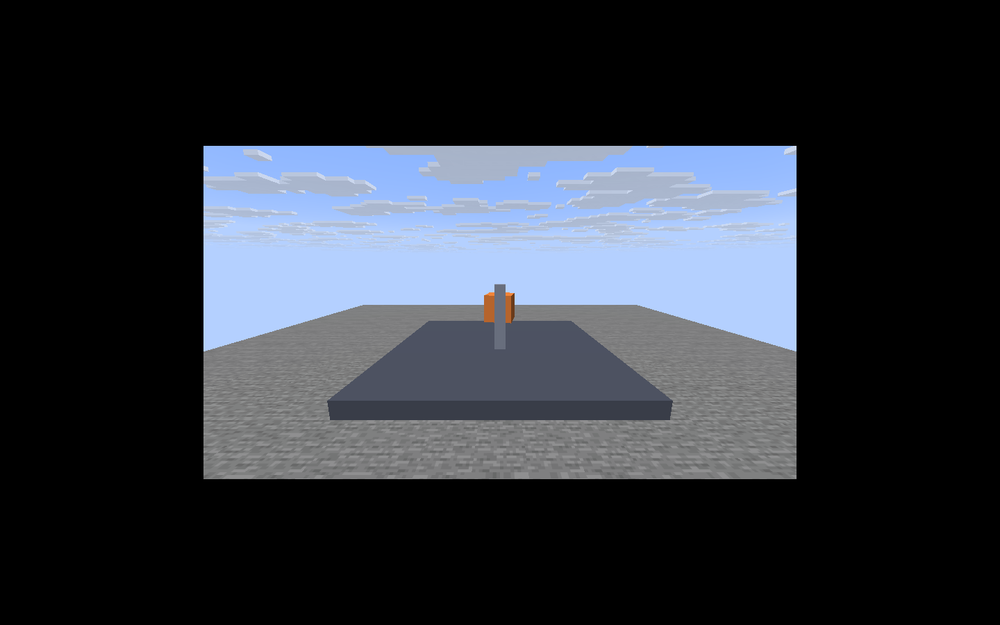
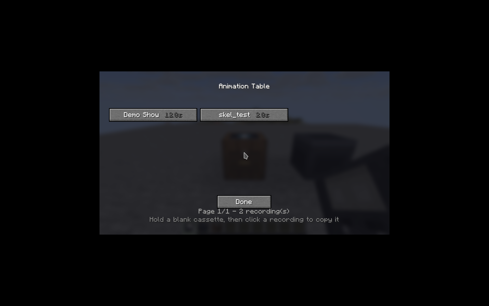
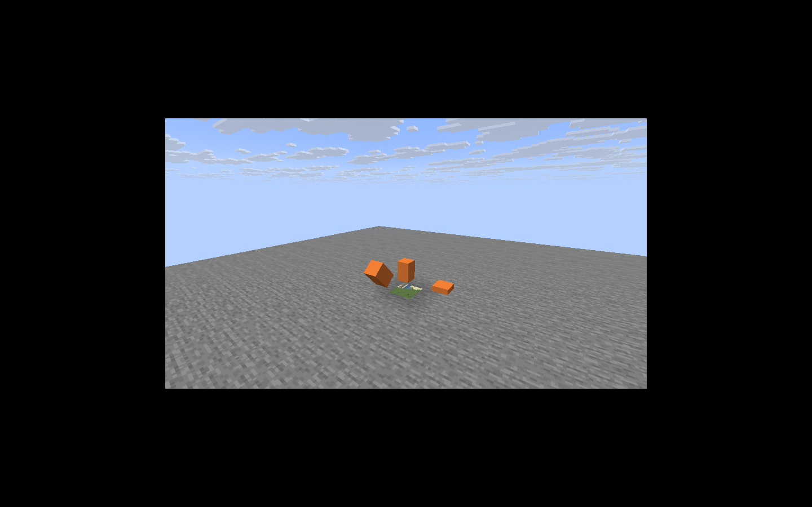

# CineCorder

Мод для **Minecraft Java 26.3 (Fabric)**, который превращает 3D-анимацию из Blender в
«киносеанс» внутри игры:

* стол аниматора показывает GUI со списком анимаций из `config/cinecorder/animations`
  и записывает выбранную на кассету;
* поддерживаются файлы `.bcam` и **`.blend`** (`.blend` конвертируется фоновым запуском
  Blender, если он установлен на машине сервера);
* поддерживается **скелетная анимация**: арматура из Blender становится иерархией нод,
  а меш — набором жёстких кусков, привязанных к костям;
* кассета вставляется в кинопроектор; по ПКМ проектор запускает анимацию, а игрок
  пересаживается в камеру из Blender и смотрит сцену от первого лица;
* HUD и рука на время показа скрываются, проектор становится невидимым;
* Shift — выйти из камеры, Shift + ПКМ по проектору — вынуть кассету.

```
Blender ──(аддон / headless)──▶ .bcam ──▶ стол аниматора ──▶ кассета ──▶ проектор ──▶ камера
```

## Скриншоты





## Требования

| Компонент | Версия |
|---|---|
| Minecraft Java | 26.3 |
| Java | 25+ |
| Fabric Loader | 0.20.1 |
| Fabric API | 0.165.0+26.3 |
| Blender (только для `.blend`) | 4.x, на машине сервера |
| ОС | Windows, Linux, macOS (мод на Java; для `.blend` нужен Blender) |

## Сборка

```bash
./gradlew build
```

Готовый мод: `build/libs/cinecorder-1.0.0.jar`. Его нужно положить в `mods/` вместе с
[Fabric API](https://modrinth.com/mod/fabric-api) для 26.3.

Для разработки:

```bash
./gradlew runClient   # клиент
./gradlew runServer   # сервер
```

## Как играть

### Крафт

* **Стол аниматора** — доски, стеклянные панели, железные слитки.
* **Кинопроектор** — железо, стеклянные панели, редстоун-лампа.
* **Чистая кассета** — железные самородки + чёрный краситель (2 шт.).

### Запись кассеты

1. Положите `.bcam` и/или `.blend` файлы в `config/cinecorder/animations/`
   (папка создаётся при первом запуске сервера, туда же копируется демо `demo_show.bcam`).
2. ПКМ по столу — откроется список анимаций. Работает пейджинг, видна длительность.
3. Возьмите **чистую кассету** в руку и нажмите на запись в списке — анимация скопируется
   на кассету. Файлы `.blend` при первом обращении конвертируются в фоне; если запись
   ещё не готова, мод попросит подождать пару секунд и нажать снова.

Кассета хранит только короткую ссылку: SHA-1 содержимого и имя исходного файла. Сам JSON
сервер складывает в `config/cinecorder/cassettes/<sha1>.bcam` и при первом показе отправляет
клиенту сжатым (gzip) большим payload'ом; клиент кэширует клип в памяти. Это принципиально:
NBT-строки ограничены 65535 байтами, поэтому большие анимации нельзя хранить прямо в
предмете.

Кассету можно передавать другим игрокам: на сервере, где есть файл в `cassettes/` (или
исходник в `animations/`), она работает. Старые кассеты со встроенным JSON поддерживаются.

### Показ

1. Поставьте проектор. Сцена размещается вокруг центра блока; во время показа проектор
   становится невидимым, так что его можно спрятать в декорации.
2. ПКМ кассетой — вставить.
3. ПКМ пустой рукой — начать показ (и сесть в камеру). Повторный ПКМ другим игроком —
   присоединиться к просмотру. HUD и рука на время показа скрыты.
4. Shift — выйти из камеры. Shift + ПКМ — остановить и вынуть кассету. Обратите внимание:
   ванильный Minecraft не использует блок при Shift+ПКМ, если в руке есть предмет, — для
   извлечения кассеты рука должна быть пустой.

Пока идёт показ, проектор выдаёт сигнал компаратору (15), как проигрыватель.

### Команды

```
/cinecorder list                 — список доступных анимаций
/cinecorder reload               — перечитать папку (после добавления файлов)
/cinecorder give <имя>           — выдать кассету (оператор)
/cinecorder open <x> <y> <z>     — открыть стол аниматора (оператор)
/cinecorder record <x> <y> <z> <имя> — записать анимацию на кассету в руке (оператор)
/cinecorder play <x> <y> <z>     — запустить показ и сесть в камеру (оператор)
/cinecorder stop <x> <y> <z>     — остановить показ (оператор)
```

## Настройка `.blend`

`config/cinecorder/config.json`:

```json
{
  "blenderPath": "blender",
  "blenderTimeoutSeconds": 300,
  "blendFrameStep": 1,
  "blendMeshDetail": "auto",
  "blendTriangleBudget": 40000,
  "convertBlendFiles": true
}
```

* `blenderPath` — путь к исполняемому файлу Blender (или имя в `PATH`). На Windows
  указывайте путь через прямой слэш, например
  `"C:/Program Files/Blender Foundation/Blender 4.5/blender.exe"`.
* `.blend` конвертируется командой
  `blender --background <файл> --factory-startup --python-exit-code 1 --python <экспортёр> -- --output <out> --all --step 1`.
* Результат кэшируется в `config/cinecorder/cache/<имя>-<mtime>.bcam`, лог ошибок —
  `config/cinecorder/cache/<имя>.log`. Изменение `.blend` (новый mtime) запускает
  повторную конвертацию.
* `blendFrameStep` — сэмплировать каждый N-й кадр (2–3 ускоряет длинные клипы, движение
  остаётся линейным между ключами).
* Конвертация идёт в отдельном потоке и не блокирует сервер. Если Blender не установлен,
  в GUI будет «converting…», а при попытке записи — понятная ошибка.

### Автоматическая пересборка формата

У `.bcam` есть поле `formatVersion`. Если мод обновился и формат изменился, ничего вручную
перезаписывать не нужно:

* при старте сервера все `.blend` из `animations/` переконвертируются в актуальный формат
  (прогресс виден в логе);
* старые файлы кассет в `config/cinecorder/cassettes/` обновляются из исходного `.blend`
  при первом показе, а также фоновым тиком раз в минуту;
* `/cinecorder rebuild` принудительно запускает пересборку;
* клиенту нужен перезаход/перезапуск, чтобы сбросить кэш клипа в памяти.

Если для кассеты нет исходного `.blend` в `animations/`, пересобрать её не из чего — она
останется в старом формате (и может выглядеть неправильно). В этом случае её нужно
записать заново.

### Если `.blend` конвертируется долго

Время зависит не от размера файла, а от **количества кадров × сложности сцены**: Blender
пересчитывает dependency graph на каждый кадр (модификаторы, арматура, констрейнты).
В серверном логе виден прогресс:

```
heavy.blend conversion: 121/240
heavy.blend conversion: 217/240
Converted heavy.blend -> heavy-...-v4.bcam in 769 ms
```

Что делать:

1. Посмотреть `config/cinecorder/cache/<имя>.log` — там полный вывод Blender и ошибки.
2. Уменьшить диапазон кадров (`scene.frame_start/frame_end`) — лишние кадры не нужны.
3. Увеличить `blendFrameStep` до 2–3 для длинных клипов.
4. Скрыть/исключить из view layer декорации и тяжёлые объекты, которые не участвуют
   в анимации: скрытые (`hide_viewport` / eye icon) и исключённые коллекции не экспортируются.
5. Для очень тяжёлых сцен проще один раз экспортировать `.bcam` аддоном на машине
   художника и положить в игру уже готовый файл.

Раньше конвертация вызывала `frame_set` для каждой кости на каждом кадре
(O(костей × кадров) пересчётов сцены). Сейчас — ровно один пересчёт на кадр, поэтому
риг из 30 костей и 240 кадров конвертируется меньше чем за секунду.

## Экспорт из Blender

Аддон: `tools/blender/cinecorder_export.py` (эта же копия лежит в jar и используется для
`.blend`).

1. `Edit → Preferences → Add-ons → Install…` → выбрать файл → включить аддон.
2. `File → Export → CineCorder Animation (.bcam)`.

### Скелетная анимация

* Добавьте к мешу Armature-модификатор и vertex groups с именами костей.
* Каждая кость становится нодой с родителем (`parent`), поза сэмплируется по кадрам.
* Скиннинг **плавный**: для каждого вертекса экспортируются до 4 весов и bind-матрица кости,
  поэтому руки/плащи/сапоги деформируются как в Blender. Кости без геометрии (IK/control bones
  вроде IK/control-костей) разрешены: они нужны только как родители.
* Крупные/детальные статические объекты экспортируются реальными треугольниками, мелкие —
  bounding box'ами.
* Бюджет треугольников по умолчанию 40 000 (`blendTriangleBudget` в конфиге), детализация —
  `blendMeshDetail` (`auto` / `triangles` / `boxes`). Для слабых GPU уменьшите бюджет.
* Меши без арматуры (и объекты, привязанные к кости без групп) экспортируются как раньше —
  одной нодой с запечённым мировым трансформом.
* Цвет куска берётся из первого материала объекта.

### Что ещё экспортируется

* Трансформации запекаются по кадрам (ключи, драйверы, констрейнты, родители).
* Активная камера сцены становится кинокамерой (позиция + точка взгляда).
* Blender Z-up конвертируется в Minecraft Y-up, 1 единица Blender = 1 блок (параметр Scale).
* Оригинал сцены должен быть вокруг начала координат Blender — эта точка станет центром
  блока-проектора.

## Формат `.bcam`

JSON (см. `src/main/resources/assets/cinecorder/demo/demo_show.bcam`):

```json
{
  "format": "cinecorder/2",
  "formatVersion": 2,
  "name": "Demo Show",
  "fps": 24,
  "duration": 12.0,
  "loop": true,
  "nodes": [
    {
      "name": "root",
      "parent": -1,
      "pivot": [0, 0, 0],
      "parts": [
        { "from": [-0.25, 0, -0.25], "to": [0.25, 0.8, 0.25], "color": [0.95, 0.5, 0.22] }
      ],
      "keys": [
        { "t": 0.0, "pos": [0, 0, 0], "rot": [0, 0, 0], "scale": [1, 1, 1] }
      ]
    },
    {
      "name": "arm",
      "parent": 0,
      "parts": [
        { "from": [-0.25, 0, -0.25], "to": [0.25, 0.8, 0.25], "color": [0.95, 0.5, 0.22] }
      ],
      "keys": [
        { "t": 0.0, "pos": [0, 1, 0], "rot": [0, 0, 0] },
        { "t": 1.0, "pos": [0, 1, 0], "rot": [70, 0, 0] }
      ]
    }
  ],
  "camera": {
    "fov": 70,
    "keys": [
      { "t": 0.0, "pos": [0, 3, 8], "look": [0, 1.2, 0] },
      { "t": 12.0, "pos": [0, 3, 8], "look": [0, 1.2, 0] }
    ]
  }
}
```

* `t` — секунды; `rotq` — кватернион `[x, y, z, w]` (основной способ, без проблем с порядком
  Эйлера); `rot` — углы Эйлера XYZ в градусах (для старых/ручных файлов);
  `color` — `[r, g, b]` или `#rrggbb`;
* скиннинг: у кости может быть `bind` (16 чисел, обратная rest-матрица), у меша — `weights`
  (по 4 пары «индекс кости, вес» на вертекст);
* `parent` — индекс родительской ноды (родитель должен идти раньше ребёнка), `pivot` —
  точка вращения в локальном пространстве ноды;
* `parts` задаются в локальном пространстве ноды (для костей — в rest-пространстве кости);
* `camera.keys` задаёт позицию и точку взгляда — из них вычисляются yaw/pitch;
* `loop` повторяет клип; `scale` масштабирует всю сцену.

## Как это устроено

* **Данные** не лежат в предмете: кассета ссылается на файл в `config/cinecorder/cassettes`.
  Клиент запрашивает клип при первом показе, сервер отправляет gzip-JSON большим payload'ом
  (Fabric сам режет его на пакеты), клиент парсит в фоне и кэширует. Это обходит лимит NBT
  в 64 КБ и не раздувает инвентарь/сеть при каждом обновлении предмета.
* **Сервер** в тике блока-проектора сэмплирует камеру и двигает невидимую сущность
  `cinecorder:camera_rig`; зрителям отправляется ванильный `ClientboundSetCameraPacket`.
  Клиент интерполирует позицию/поворот сущности, поэтому камера двигается плавно.
* **Клиент** рисует сцену в событии Fabric `LevelRenderEvents.COLLECT_SUBMITS`: боксы
  собираются через `submitCustomGeometry` с `RenderTypes.entitySolid`. Рендер не зависит от
  видимости чанка проектора — это важно, когда кинокамера смотрит в сторону от блока.
* Иерархия нод перемножается на клиенте (`AnimationClip.worldMatrices`), камера — на сервере;
  время берётся из `level.getGameTime()` и `startGameTime`, поэтому опоздавший зритель видит
  тот же кадр, что и остальные.
* GUI стола — обычный `Screen` с кнопками; сервер присылает список (`OpenTablePayload`),
  клиент отправляет выбор (`TableSelectPayload`), запись выполняет block entity с проверкой
  расстояния и кассеты в руке.

## Ограничения

* Скиннинг жёсткий: один кусок = одна кость, плавных весов нет.
* Камера Minecraft не поддерживает крен (roll) и изменение FOV из анимации.
* Тени и динамический свет не поддерживаются: сцена рендерится с полной яркостью (как экран
  проектора), чтобы не становиться чёрной в пещере или ночью. Тёмные материалы из Blender
  (цвет ~0.01) остаются тёмными — это художественное решение сцены, а не ошибка рендера.
* Крупные детальные меши рисуются треугольниками (двусторонними); на слабой встроенной
  графике это может снизить FPS. Уменьшите `blendTriangleBudget` или поставьте
  `"blendMeshDetail": "boxes"`.
* Сцена рисуется поверх мира и не вырезает его. Если в анимации есть большая плоскость/пол,
  она закроет игровой пол — это содержимое сцены, а не пропавший чанк. Тёмные объекты
  (цвет ~0.01) остаются тёмными: это материал из Blender.
* Первый показ очень большого клипа (десятки мегабайт JSON) требует передачи и парсинга:
  несколько секунд и заметная память. Дальше клип берётся из кэша.
* Папка `cassettes/` хранит копии записанных анимаций; её можно чистить, но кассеты,
  ссылающиеся на удалённые файлы, перестанут работать (если нет исходника в `animations/`).
* `.blend` требует установленного Blender на сервере; конвертация запускается по требованию.
* Показ идёт по серверному времени (20 тиков/с); на лагающем сервере возможен рассинхрон.

# ЭТОТ МОД ПОЛНОСТЬЮ AIAIAIAIAI SLOP, а если вы хотите что-то добавить, предложить идею или у вас ошибка то пишите я попытаюсь помочь
